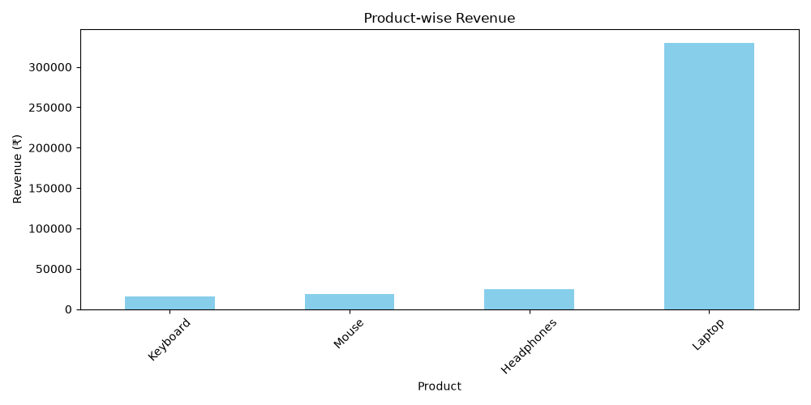
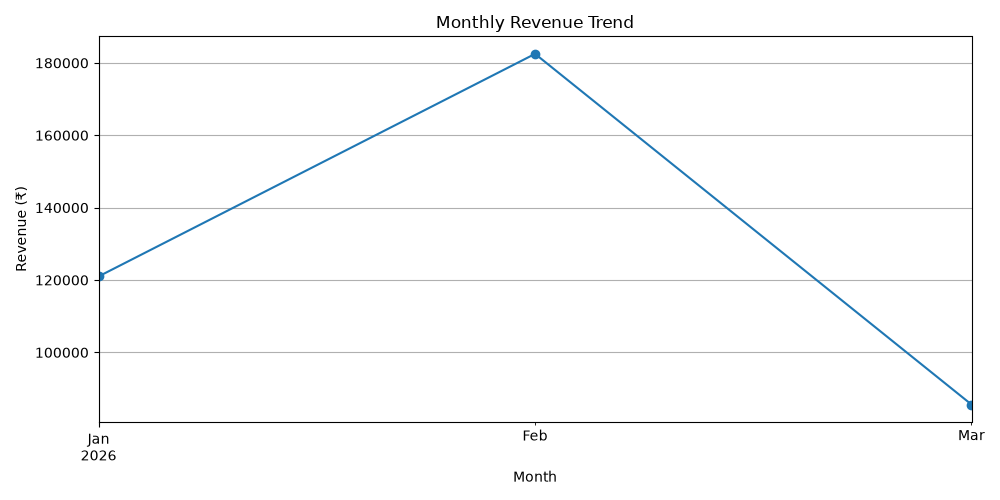

# Sales Data Analysis System

## About the Project
This project analyzes sales data using Python, Pandas, and Matplotlib. It calculates revenue, compares product performance, analyzes regional sales, and identifies monthly revenue trends.

## Features
- Loads sales data from a CSV file
- Calculates revenue for each sale
- Calculates total units sold and total revenue
- Analyzes product-wise revenue
- Identifies the highest-revenue product
- Analyzes region-wise revenue
- Tracks monthly revenue trends
- Generates charts for data visualization
- Exports analyzed data to a CSV report

## Technologies Used
- Python
- Pandas
- Matplotlib
- CSV

## Project Files
- `main.py` — Main analysis program
- `sales.csv` — Sample sales dataset
- `sales_report.csv` — Exported analysis report
- `product_revenue.png` — Product revenue chart
- `monthly_revenue.png` — Monthly revenue chart

## How to Run

1. Install Python.
2. Install the required libraries:

   `pip install pandas matplotlib`

3. Run the program:

   `python main.py`

## Learning Outcomes
This project demonstrates data cleaning basics, data analysis, grouping and aggregation, revenue calculations, data visualization, and CSV report generation.

## Author
Aryan Ninawe

GitHub: https://github.com/aryanninawe811
## Visualizations

### Product-wise Revenue

### Monthly Revenue Trend

